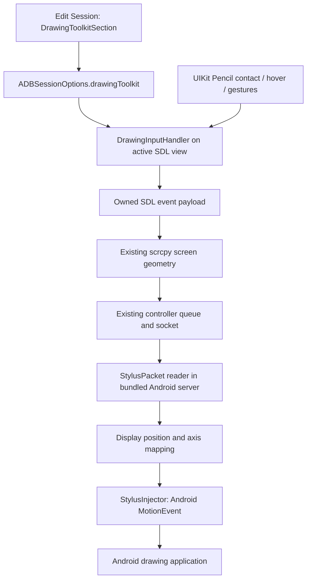

# Drawing Toolkit for Scrcpy Remote 4.6.0

In an ADB session, open **Edit Session → Drawing Toolkit**, enable the toolkit,
save, and connect. Use Apple Pencil on the streamed Android screen. Settings
are stored with that session; reconnect after editing them.

## Controls

| Control | Behavior |
| --- | --- |
| Pencil Mode | Stylus, stylus without hover, mouse, or touch compatibility input. |
| Stroke Type | Regular sends UIKit movement events. HD processes real coalesced samples; it never sends predicted positions. |
| Tick Interval | Minimum interval between HD movement samples, in microseconds. Down, up and cancellation are always sent. |
| Pencil Tip Offset | Horizontal and vertical offsets in local view points, with a Pencil test area. |
| Pressure Curve | Editable cubic curve, 2,048-level lookup table, reset and undo. Disable it for direct normalized pressure. |
| Pressure Range Test | Draw light and firm strokes, then apply the measured range. Uses the 5th–95th percentile to reduce outliers. |
| Hook Filtering Depth | In HD mode, initial samples have zero pressure to suppress the stroke-start hook. |
| Equalization Depth / Force Scaling | Gradually return the initial force scale to one. Zero depth disables equalization. |
| Transmit Tilt and Orientation | Send Pencil altitude/azimuth as Android tilt/orientation, including display transforms. |
| Use Eraser | Send Android's eraser tool type instead of the pen tool. |
| Drawing Pauses Native Touch | Cancel existing finger contacts when a pen stroke starts and suppress fingers until they lift. |
| Disable Slide Gesture for Pencil | Exclude Pencil from existing view/ancestor touch recognizers while streaming. System gestures remain under iPadOS control. |
| Double Tap | Switch pen/eraser, repeat a keyboard shortcut, or alternate two shortcuts. |
| Squeeze | Separate press/release shortcuts, or hold a shortcut until squeeze ends. |

Shortcuts support A–Z, 0–9, F1–F12, Space, Enter, Tab, Esc, Backspace,
Delete and arrow directions, with Control, Shift, Alt and Meta. Custom double
tap shortcuts take priority over tool switching. The tool is fixed for the
duration of a stroke; switching affects the next stroke.

The Android app must consume stylus pressure/tilt/eraser events to use those
features. Hover, double tap and squeeze depend on the Pencil/iPad hardware;
squeeze requires iPadOS 17.5 or later. Apple Pencil USB lacks pressure
sensitivity. Mouse/touch modes are compatibility modes and do not make an
Android app support pen-specific features. Windows Ink and Qt are references
for event semantics; this iOS app obtains actual input from UIKit.

## Repository architecture and integration

The current application is `scrcpy-app/Scrcpy Remote.xcodeproj`. The
`scrcpy-ios` directory and parts of the root README describe the older client.
The source import preserves both, plus the existing submodule references.

| Area | Responsibility and dependencies |
| --- | --- |
| `Scrcpy_RemoteApp`, `MainContentView`, `SessionsView` | SwiftUI application shell, saved sessions and connection presentation. |
| `SessionManager`, `SessionCreateView` | Codable session persistence and native SwiftUI forms. The editor keeps local state because session models are reference types. |
| `SessionConnectionManager`, `SessionNetworking` | Select the session/client, coordinate connection status, network setup, actions and lifecycle. |
| `ScrcpyClientWrapper`, `ScrcpyBlockWrapper` | Objective-C boundary between Swift, ADB and VNC clients. |
| `ADBClient`, `ScrcpyADBClient`, `ScrcpyRuntime` | ADB pairing/commands, session-to-scrcpy arguments, bundled server upload and scrcpy runtime. |
| `VNCClient` | Existing libvncclient/audio path and the shared SDL runtime/framework. |
| `SDLUIKitDelegate+Extend`, `SDL_uikitviewcontroller+Extend`, `ScrcpyMenuView*` | UIKit/SDL lifecycle, streaming controls, keyboard, gestures and overlays. |
| `ActionsView`, `ActionCreation*`, `ScrcpyActionsBridge` | Existing action configuration and ADB/VNC execution. |
| `TailscaleManager`, `porting/libtsnet` | Go tsnet forwarding exposed through a C archive. |
| `BackgroundKeepAliveManager`, `ScrcpyLiveActivityManager`, widget target | Background status and Live Activity integration. |
| `porting/src` | C/Objective-C adaptations of upstream scrcpy, using wrapper includes to preserve upstream behavior. |
| `porting/server` | Java overlays for the Android server built from the pinned scrcpy source. |
| `external`, `ios-cmake`, `scrcpy` | ADB, OpenSSL, VNC, cross-compilation and upstream scrcpy dependencies. SDL and FFmpeg sources are obtained by the existing build scripts. |

The editor uses `Form`, `Section`, native `Toggle`/`Picker`/`Stepper`/`Slider`,
navigation links and semantic colors. The new section follows those patterns,
including light/dark appearance and accessibility-adjustable curve points.
New settings live under `ADBSessionOptions.drawingToolkit`; missing or invalid
fields decode to safe defaults. The toolkit defaults to disabled for old and
new sessions. It adds no VNC setting or new scrcpy command-line flag.

`ScrcpyPencilRouting` intercepts the four UIKit touch methods on SDL's view.
Only enabled ADB sessions consume Pencil contacts. Other input uses the
original SDL methods. SDL's built-in Pencil hover recognizer is temporarily
disabled to avoid a second synthetic mouse stream. The handler restores
recognizers and releases held input when invalidated.

Input is queued through SDL rather than dereferencing the scrcpy controller
on the UIKit callback path. SDL payloads contain values, not heap pointers.
The scrcpy event loop applies its existing letterbox, rotation and reflection
mapping. Stroke starts outside the video rectangle are ignored; subsequent
coordinates are clamped to the frame. The server maps both the tip and pen
direction with one display snapshot. Size changes reject stale events and
cancel the active pen. A separate injector keeps pen state separate from the
pre-existing finger path and its timing adjustment.

## Wire extension

Stock scrcpy touch messages cannot carry the complete pen tool and axes. The
matching client and bundled Android server therefore add private control type
128, version 1, with 34 bytes per message:

| Offset | Bytes | Field |
| --- | --- | --- |
| 0 | 1 | Type = 128 |
| 1 | 1 | Version = 1 |
| 2 | 1 | Android action (down/up/move/cancel/hover enter/move/exit) |
| 3 | 1 | Android tool type (finger=1, stylus=2, mouse=3, eraser=4) |
| 4, 8 | 4 each | Signed X and Y in video pixels |
| 12, 14 | 2 each | Unsigned video width and height |
| 16 | 2 | Pressure, unsigned 0–65535 representing 0–1 |
| 18 | 2 | Tilt, unsigned 0–65535 representing 0–π/2 |
| 20 | 2 | Orientation, signed ±32767 representing ±π |
| 22 | 4 | Android button mask |
| 26 | 8 | Client sample timestamp in microseconds |

Multibyte values are big-endian. The reader rejects malformed versions,
actions, tools and dimensions. Client nonfinite values are sanitized.
Only movement messages may be discarded by the controller under congestion;
contact/hover boundaries and drawing shortcut key events are nondroppable.
Internal queue type 129 serializes to an ordinary scrcpy key message. Existing
stock protocol encodings are unchanged. Use the Android server produced by
this repository with the modified client.

## Build and verification

GitHub Actions `Build Scrcpy Remote IPA` builds the native device libraries,
the matching Android server and an unsigned device archive with Xcode 26.3.
Its IPA artifact is `ScrcpyRemote-4.6.0-unsigned-IPA`. Signing is performed by
the user's sideloading tool. Native dependencies are cached only after a
successful, explicitly checked build. Build scripts fail on compiler errors
and publish diagnostics. The original local dependency scripts remain intact;
clean-runner compatibility adaptations are performed in CI's checkout.

`Drawing Toolkit Tests` runs the portable C wire fixture, Swift persistence,
pressure and shortcut tests, SwiftUI type-checking, an iPad simulator preview,
and Android server tests. The Android reader consumes bytes emitted by the C
serializer and then reads a stock message to verify framing. Axis tests cover
rotation and reflection. Simulator screenshots exercise the production views
in a small preview host, not a connected device stream.

Physical-device acceptance remains necessary: connect a pressure-capable
Pencil/iPad to an Android drawing app, vary pressure/tilt, test eraser and
hover, rotate both displays, draw near letterboxes, rest a finger while
drawing, exercise double tap/squeeze holds, background/reconnect mid-stroke,
and confirm disabling the toolkit restores the existing input path. Automated
builds and simulator images cannot establish hardware behavior or latency.
