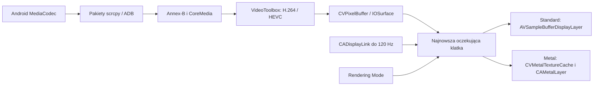

# Natywne wideo i wybór renderera

Ustawienia → Video → Rendering Mode zawierają dokładnie dwa tryby: **Standard** (domyślny) i **Metal (Experimental)**. Ustawienie jest globalne, zachowuje się po ponownym uruchomieniu i obowiązuje od następnego połączenia ze sprzętowym dekodowaniem. Wyłączenie sprzętowego dekodowania pozostawia dotychczasową ścieżkę FFmpeg/SDL.

Bezpośrednie dekodowanie sprzętowe H.264/HEVC jest aktywne od iOS/iPadOS 17 (w tym 17.5.1). Na starszych obsługiwanych systemach pozostaje wcześniejszy dekoder FFmpeg/VideoToolbox; minimum aplikacji nadal wynosi iOS 15. Te systemy nie mają nowych kluczy API wymagających sprzętowego dekodera.

## Przepływ obrazu

W ramach jednej sesji tworzony jest tylko wybrany renderer. Nie ma detekcji HDR, tone mappingu, EDR ani przełączania AVSB/Metal według metadanych koloru. Metal obsługuje SDR NV12 i P010 (10 bitów samo w sobie nie oznacza HDR), zakres pełny/wideo i macierze BT.601/709.

## Co pochodzi z analizy VoidLink

Źródła referencyjne sprawdzono lokalnie w `C:\Users\Admin\Documents\VoidLink-previously-moonlight-zwm\VoidLink`:

| Mechanizm | VoidLink | Nasza implementacja |
|---|---|---|
| Wybór backendu | `Stream/VideoDecoderRenderer.m`, `Base.lproj/iPad.storyboard`, `SettingsSwiftUI.swift` | Te same dwa rodzaje rendererów i nazwy opcji; Standard domyślny. |
| H.264/HEVC | `Stream/VideoDecoderRenderer.m` | Parametry SPS/PPS/VPS, zamiana Annex-B na NAL z długością, CoreMedia → natywne VideoToolbox. |
| Współdzielone bufory GPU | `Metal/MetalVideoRenderer.m` | IOSurface → CVMetalTextureCache → tekstury Y/UV; bez odczytu i przesyłania pikseli przez CPU. |
| Ograniczenie zaległości | `Utility/FrameQueue.m` | Jeden najnowszy oczekujący bufor, jeden zaplanowany worker, do trzech operacji dekodera i GPU w toku. |
| Priorytet i odświeżanie | `Metal/MetalView.m`, `Metal/MetalViewController.m` | Worker user-interactive, CADisplayLink w common modes, częstotliwość ograniczona możliwościami ekranu. |
| Kolor SDR i geometria | `Metal/MetalVideoRenderer.m` | Przeliczenie YUV na RGB na GPU, zachowanie proporcji obrazu, czarne pasy. |

To adaptacja architektury do strumienia scrcpy i iPadOS 17.5.1, a nie skopiowanie całego silnika VoidLink. Zachowano własny protokół ADB, geometrię wejścia i Drawing Toolkit. Nie dodano funkcji Sunshine, interpolacji wymagającej iOS 26 ani HDR. Nie skopiowano też blokującego `waitUntilCompleted` z pętli Metal VoidLink: bufory są zwalniane po asynchronicznym ukończeniu GPU. Flaga asynchronicznego dekodowania VideoToolbox jest ustawiona jawnie; sam output handler nie implikuje jej ustawienia.

## Własność i odzyskiwanie

Pakiety skompresowane zachowują kolejność i zależności klatek. Po utracie sesji dekodera aplikacja czeka na klatkę kluczową i korzysta z istniejącego ogranicznika żądań resetu Androida. Zmiana formatu, tło, rozłączenie i ponowne połączenie opróżniają prace dekodera przed zmianą stanu. Późny wynik dekodowania nie cofa prezentacji do wcześniejszego PTS.

AVFrame pozostaje opakowaniem własności i wymiarów wymaganym przez istniejące sinks scrcpy. Dla natywnego H.264/HEVC nie wykonuje dekodowania ani konwersji pikseli. FFmpeg nadal jest potrzebny dla dźwięku, AV1, dekodowania programowego, struktur pakietów i nagrywania. Nie zmieniono przypiętych wersji zależności, enkodera Androida, bitrate ani rozdzielczości.

Nowy renderer wymaga bezpośredniego linkowania systemowego `Metal.framework` w aplikacji. Kontrola zgodności dopuszcza dokładnie ten dodatkowy framework Apple i nadal sprawdza pozostałe biblioteki, ich wersje oraz komplet zasobów. Nie jest to nowa biblioteka zewnętrzna ani aktualizacja FFmpeg/SDL.

## Walidacja

- `test_annexb.c`: prefiksy 3/4 bajty, granice danych, padding, emulation prevention i puste NAL.
- `test-native-video.sh`: rzeczywiste próbki H.264 i HEVC, zmiany wymiarów, IOSurface, reset, oczekiwanie na IDR, błędne dane i asynchroniczna seria klatek.
- `NativeVideoTests.m`: piksele z rzeczywistego GPU Metal, kolory podstawowe, czerń/biel, zakres pełny/wideo, P010 SDR, proporcje i własność bufora do ukończenia GPU.
- `FramePresenterTests.m`: zaległości, pauza, restart oraz wyłączność warstw po zmianie Standard → Metal → Standard.
- Pozostają testy dotyku, Drawing Toolkit, Androida i porównanie bibliotek/zasobów IPA z v4.6.0.

Testy Maca i symulatora nie mierzą fizycznych 120 FPS ani opóźnienia Xiaomi → iPad. Na iPadzie Pro M2 / iPadOS 17.5.1 należy porównać oba tryby przy identycznym kodeku, rozdzielczości, bitrate i FPS=120, osobno dla H.264 i HEVC. Sprawdzić przewijanie, Pencil, obrót, multitasking, przejście do tła, nagrywanie i reconnect. Log `[NativeVideo]` potwierdza ścieżkę dekodowania; `[FramePacing] renderer=...` potwierdza backend. Licznik `renderCalls` oznacza wywołania renderera, nie pomiar fizycznego ekranu.
