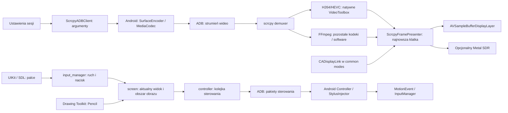

# Audyt obrazu, dotyku i 120 Hz

Ten dokument opisuje wcześniejszy etap audytu i zmian dotyku/ProMotion. Opis jednej oczekującej klatki, osobnego workera i common modes dotyczył wtedy obu rendererów. Standard został następnie zastąpiony queue buffering VoidLink; aktualne zachowanie i testy opisuje [voidlink-standard-pacing.md](voidlink-standard-pacing.md), a obecny przepływ dekodowania i obu rendererów — [native-video-rendering.md](native-video-rendering.md).

Data: 2026-10-13. Baza aplikacji przed zmianą: `945c572`.
Źródło porównawcze: lokalny katalog `C:\Users\Admin\Documents\VoidLink-previously-moonlight-zwm`.
Sprzęt do końcowego sprawdzenia: iPad Pro 12,9 cala M2, iPadOS 17.5.1, fizyczny telefon Xiaomi.

## Wynik

W kodzie były konkretne mechanizmy mogące zwiększać opóźnienie: sztucznie przesuwany zegar dotyku na Androidzie, pozostawianie starych ruchów w kolejce oraz zastępowanie krótkich wywołań pętli SDL czasem do 0,5 s. Sprzętowe dekodowanie VideoToolbox i natywna warstwa AVSampleBufferDisplayLayer istniały już przed zmianą. Nie było potrzeby usuwania FFmpeg, SDL, obsługi dźwięku ani Drawing Toolkit.

Nowa prezentacja żąda częstotliwości do 120 Hz, pracuje także podczas śledzenia gestów, przechowuje najwyżej jedną oczekującą klatkę i wykonuje operacje prezentacji na osobnej kolejce. To usuwa wskazane ograniczenia klienta. Nie jest dowodem, że Xiaomi, jego aktualna aplikacja i enkoder dostarczą 120 różnych klatek na sekundę. Ostatecznego zachowania Infinite Painter i multitaskingu nie można potwierdzić bez urządzeń.

## Mapa zależności

Główne miejsca w naszej aplikacji:

| Obszar | Pliki i odpowiedzialność |
|---|---|
| Konfiguracja | `scrcpy-app/ADBClient/ScrcpyADBClient.m`: opcje sesji, niestandardowe flagi, `--max-fps`, uruchomienie i zakończenie scrcpy. |
| Odbiór obrazu | `scrcpy/app/src/demuxer.c`, `decoder.c`; nakładki `porting/src/demuxer-porting.c`, `decoder-porting.c`: pakiety, FFmpeg, odzyskiwanie dekodera. |
| Dekodowanie sprzętowe | H.264/HEVC: `ScrcpyVideoDecoder.m` i `ScrcpyNativeVideoBridge.m` przekazują pakiety bezpośrednio do VideoToolbox. FFmpeg pozostaje dla pozostałych ścieżek; `AVFrame.data[3]` służy też jako opakowanie własności natywnego bufora. |
| Prezentacja | `ScrcpyFramePresenter.m`: własność klatek, zegar, kolejka robocza, pauza i restart. `ScrcpyRuntime.m`: opakowanie bufora i przekazanie do warstwy. |
| Okno i gesty | `scrcpy-app/Scrcpy Remote/SDL_uikitviewcontroller+Extend.m`, `porting/src/screen-porting.c`, `input_manager-porting.c`: geometria i przekazywanie zdarzeń. |
| Palce | `scrcpy/app/src/input_manager.c`, `mouse_sdk.c`, `control_msg.c`; nakładki w `porting/src`: ACTION_DOWN/MOVE/UP, pozycja, identyfikatory palców, nacisk. |
| Pencil | Istniejący Drawing Toolkit, `porting/src/stylus-porting.c`, `stylus-protocol.h`, Android `StylusInjector.java` i `StylusPacket.java`. Struktura pakietu i parametry rysika zachowane. |
| Kolejka sterowania | `scrcpy/app/src/controller.c` i `porting/src/controller-porting.c`: mutex, kolejka, wysyłający wątek ADB. |
| Wstrzykiwanie na Androidzie | `porting/server/src/main/java/com/genymobile/scrcpy/control/Controller.java`: stan wskaźników i MotionEvent. |
| Wspólna pętla iOS | `scrcpy-app/VNCClient/ScrcpyCommonRuntime.m`: funkcja podmieniona podczas budowy SDL. Nowy krótki czas dotyczy aktywnej sesji ADB. |

## Zgłoszone problemy

| Problem | Stan przed zmianą | Wprowadzona zmiana | Co pozostaje do sprawdzenia |
|---|---|---|---|
| Narastające opóźnienie ruchu | Android używał poprzedniego `lastTouchCont`, a przy większej przerwie dodawał tylko 16,666 ms. Przy 30 zdarzeniach/s zegar zdarzeń mógł pozostawać coraz bardziej w tyle. Zapełniona kolejka sterowania odrzucała nowe ruchy, zachowując stare. | `MotionEvent` otrzymuje bieżący `SystemClock.uptimeMillis()`. Niewysłany ruch danego palca zastępuje się nowszym w tym samym odcinku gestu. Analogicznie usuwane są zaległe ruchy w kolejce SDL. DOWN/UP, klawisze, scroll i Pencil stanowią granice. | Wielominutowe przeciąganie i gesty na fizycznym Xiaomi; opóźnienie sieci nadal istnieje. |
| Infinite Painter #84 | Wniosek z docs o braku TOOL_TYPE_FINGER był nieprawdziwy dla tej bazy. Typ narzędzia, źródło TOUCHSCREEN i ACTION_MOVE już istniały. Istniała też korekta zerowego nacisku i cancel, lecz korzystała z globalnego obserwatora SDL. | Normalizacja nacisku palca jest teraz wykonywana przy odczycie zdarzenia; cancel staje się UP. DOWN/UP nie są zdarzeniami odrzucanymi przy przeciążeniu. Naprawiony zegar zdarzeń. | Rysowanie palcem zależy także od ustawień Painter. Test z włączonym rysowaniem palcem, osobno od testu Pencil. Nie ma jeszcze potwierdzenia usunięcia całego zgłoszenia #84. |
| Ustawione 120 FPS, widoczne 60 | Sam `--max-fps` określa limit Androida. Natywna warstwa działała bez własnego zegara ProMotion. Funkcja obsługi pętli SDL ignorowała żądany czas 2 µs i mogła czekać 0,5 s. | Wspólna normalizacja docelowego FPS po uwzględnieniu flag, CADisplayLink w common modes, deklaracja ProMotion, prezentacja z czasem docelowej klatki, osobna kolejka oraz pojedyncza oczekująca klatka. Przy aktywnym ADB zachowany jest czas żądany przez SDL. | Pomiar na M2 i strumieniu rzeczywiście generującym 120 FPS; 120 wywołań zegara nie oznacza 120 nowych klatek. |
| Slide Over / Split View #129 | Istniało mapowanie okno → obszar obrazu → Android i mechanizm ponownej synchronizacji rozmiaru. Wewnętrzny warunek ignorował jednak `force`, gdy rozmiary były równe. | Resynchronizacja respektuje `force`. Mapowanie pobiera aktualne `view.bounds` właściwego okna SDL; obszar obrazu jest odświeżany przed obsługą zdarzenia, również dla Pencil. | Powtarzane schowanie/przywrócenie Slide Over, obrót i zmiana wielkości Stage Managera. |

### Granice scalania ruchów

Scalane są wyłącznie oczekujące ruchy tego samego palca. Nowe DOWN/UP/CANCEL, zmiana rozmiaru klatki i inne rodzaje wiadomości nie mogą zostać przeskoczone. Palce zachowują własne identyfikatory. Nie zmienia to pakietów nacisku, kąta ani kierunku Pencil i nie redukuje próbek Drawing Toolkit. Szybkie rysowanie palcem przy przeciążeniu może mieć mniej punktów pośrednich; jest to świadomy kompromis na rzecz aktualnej pozycji i ograniczenia opóźnienia.

## Weryfikacja docs na podstawie VoidLink

Poniższe ścieżki odnoszą się do lokalnego katalogu VoidLink. Numery linii są orientacyjne dla tej kopii; metody wskazują właściwe miejsca niezależnie od przesunięć.

| Twierdzenie / wskazane źródło | Wynik sprawdzenia |
|---|---|
| `Utility/Plot.h`, enum AVSB/Metal | Potwierdzone: dwa backendy. Sam wybór backendu nie gwarantuje 120 Hz. |
| `Stream/VideoDecoderRenderer.m`, inicjalizacja `_sq`, `_vtq`, FrameQueue i obserwatorów | Potwierdzone. To osobne etapy odbioru/dekodowania/kolejkowania, nie dowód braku oczekiwania. |
| `reinitializeDisplayLayer`, aspect-fit i wyłączone animacje | Potwierdzone. Ręcznie wyliczany obszar pasuje obraz do widoku; warstwa ma własną konfigurację gravity. |
| `setupDecompressionSession`, wybór formatu pikseli i interpolacji | Potwierdzone. Uwaga: klucz `RequireHardwareAcceleratedVideoDecoder` umieszczono w słowniku atrybutów bufora, a `decoderSpecification` w wywołaniu tworzenia sesji jest `nil`. Sama obecność klucza nie dowodzi poprawnego wymuszenia sprzętowego dekodera. Nie skopiowano tego wzorca. |
| H.264 / H.265 i FFmpeg | Dla H.264 konfigurację tworzy `CMVideoFormatDescriptionCreateFromH264ParameterSets` (~1120), dla HEVC odpowiednik `CreateFromHEVCParameterSets` (~1159). Własny kod zamienia prefiksy Annex B na długości NAL (~1234). Nowa ścieżka wywołuje `VTDecompressionSessionDecodeFrameWithOutputHandler` (~1345); legacy/off przekazuje skompresowany sample do AVSampleBufferDisplayLayer. Te ścieżki nie dekodują obrazu przez FFmpeg. |
| „VoidLink pozbył się FFmpeg” | Nieprawda. `VoidLink.xcodeproj/project.pbxproj` linkuje libavcodec, libavformat, libavutil dla iOS i tvOS. `getAv1CodecConfigurationBox` (~848) używa `avio_*` i `ff_isom_write_av1c`; `createAV1FormatDescriptionForIDRFrame` (~885) używa `ff_cbs_*` do nagłówków AV1. Dekodowanie obrazu AV1 również przechodzi następnie przez API Apple. |
| Tworzenie CMBlockBuffer/CMSampleBuffer, VPS/SPS/PPS | Potwierdzone w `submitDecodeBuffer`. AV1 ma osobną ścieżkę konfiguracji. |
| „Dekodowanie zawsze asynchroniczne” | Wywołanie ma output handler, ale przekazuje flagi dekodowania `0`. Sam callback nie jest dowodem wymuszenia asynchronicznego trybu VideoToolbox. Dalsze przetwarzanie jest wysyłane na `_vtq`. |
| Zdekodowane bufory do AVSB / Metal, opcjonalny FrameInterpolator | Potwierdzone w `decodeFrameWithSampleBuffer`. Własność buforów i sposób opakowania zależą od backendu. |
| CADisplayLink, targetTimestamp, mnożnik interpolacji | Potwierdzone w `displayLinkFrameRateForInterpolationEnabled`, `setupWithVideoFormat`, `renderModeAVSB` i `renderFrame`. AVSB rejestruje link w **NSDefaultRunLoopMode** (~409). Common modes jest w backendzie Metal; nie należy przypisywać go wszystkim ścieżkom VoidLink. |
| AVSB render loop nigdy nie blokuje UI | Niepotwierdzone: `renderModeAVSB` może czekać na dequeue klatki. U nas callback zegara nie czeka na klatkę ani na wykonanie kolejki prezentacji. |
| FrameQueue jako adaptacyjny mechanizm usuwania zaległości | `Utility/FrameQueue.m`: ring ma pojemność 15 i domyślny high-water mark 2; występuje obsługa przepełnienia. Część opisywanej logiki slack/history jest zakomentowana. Nie jest to gotowy dowód całkowitego usunięcia opóźnienia. |
| `Metal/MetalView.m`, własny wątek | Potwierdzone: CAMetalLayer, QoS user-interactive. To klasa priorytetu, nie gwarancja czasu rzeczywistego ani odporność na każde obciążenie. |
| `Metal/MetalViewController.m`, trzy drawable i zegar | Potwierdzone: `maximumDrawableCount=3`, CADisplayLink w common modes oraz pętla wykorzystująca kolejkę klatek. |
| `Metal/MetalVideoRenderer.m`, texture cache, CSC, HDR, semafor | Potwierdzone: tekstury z CVPixelBuffer, przeliczenia BT.601/709/2020 i limity klatek. „Zero-copy” dotyczy współdzielenia bufora/tekstur, nie dowodzi braku każdej kopii na całej trasie sieć → ekran. |
| „Metal jest całkowicie asynchroniczny” | Nieprawda: po commit występuje `[commandBuffer waitUntilCompleted]` (~851). |
| `presentDrawable:afterMinimumDuration:` daje dokładnie 8,33 ms | To żądany minimalny czas, nie gwarancja idealnie równej prezentacji przy przeciążeniu lub braku nowych klatek. |
| `Stream/FrameInterpolator.swift`: 60 → 120 | Potwierdzone jako opcjonalne generowanie klatki pośredniej, zależne od obsługi urządzenia i iOS 26. Nie jest dostępne na iPadOS 17.5.1, nie podwaja próbkowania wejścia ani liczby oryginalnych klatek Androida. Nie dodano interpolacji. |
| `SettingsViewController.m`, opcja 120 tylko >62 Hz | Potwierdzone w tradycyjnym interfejsie. `SettingsSwiftUI.swift` również zawiera ograniczenia opcji; twierdzenie, że brakuje ich wszędzie, jest zbyt szerokie. |
| `Stream/StreamManager.m`, `Connection.m` | Potwierdzone przekazanie ustawień do rendererów i hosta. W `Connection.m` jest bezpośrednie `_streamConfig.fps = config.frameRate`; nie jest to globalna gwarancja normalizacji każdego wejścia. |
| `00156-issue-Custom_FPS_options.md`, `00162-issue-Variable_Refresh_Rate.md` | Dyskusje o opcjach i obsługiwanych częstotliwościach. W #162 autor wskazuje stałe kroki 60/120; zamknięcie dyskusji nie jest testem naszej aplikacji. |
| Discord `app_feedback_issues_ideas_major_performance_improvement-page-1.txt` | Opisuje doświadczenia z pacingiem, timebase i jitterem. Wyniki dotyczą tamtych konfiguracji, nie są pomiarem scrcpy na Xiaomi. |
| `Input/StreamView.h/.m`, wybór touch mode i `Database/DataManager.h` | Potwierdzone wybieranie native/pure/relative/absolute/trackpad oraz enum ustawień. Są to różne semantyki wejścia. |
| `NativeTouchHandler.h/.m`, `PureNativeTouchHandler.h/.m` | Potwierdzone identyfikatory, stan palców, filtrowanie, lokalne współrzędne, odejmowanie pasów i normalizacja. Jednak `streamViewSize` jest zapamiętany przy inicjalizacji (~57); samo użycie `locationInView` nie gwarantuje poprawności po resize. |
| `NativeTouchPointer.h/.m` | Potwierdzone divider, prędkość i reset pozycji przy przeciąganiu. To mechanizm wirtualnego sterowania grą; nie gotowa poprawka zwykłego dotyku Androida. Część geometrii jest buforowana. |
| `SettingsViewController.h/.m`, `SettingsSwiftUI.swift`, `Database/DataManager.h/.m`, `TemporarySettings.h/.m`, `Input/CustomOSC/OSCProfile.h/.m` | Potwierdzone przechowywanie i przenoszenie ustawień divider, velocity, trybów i interwałów. Ustawienia nie zastępują poprawnego zegara i ograniczenia kolejki. |
| `SettingsTouchVelocityPreview.swift` | Podgląd ustawień prędkości, nie element sieciowej pętli dotyku. |
| `LiSendTouchEvent` / `LiSendPenEvent` w StreamView | Potwierdzone; zależą od możliwości hosta Sunshine. To inny protokół niż pakiety sterowania scrcpy i Android MotionEvent. Nie można ich skopiować zamiast istniejącego kanału ADB. |
| `Input/PencilHandler.swift`, nacisk, kierunek, barrel roll | Potwierdzone natywne dane UIKit i transmisja pen/touch zależnie od ustawień i wsparcia. Nie wszystkie parametry są dostępne na każdym modelu Pencil. Obecny Drawing Toolkit zachowano. |
| `UITouchUtil.swift` | Potwierdzone filtrowanie direct/pencil i pomocnicze obliczenia gestów. Nie stanowi kolejki odrzucającej zaległe zdarzenia. |
| `TouchPadGestureHandler.swift`, pinch/inercja | Potwierdzone gesty przekładane na sterowanie myszą/scroll/klawisze i zatrzymywanie inercji. Semantyka trackpada PC różni się od dwóch palców Androida. |
| `RelativeTouchHandler.m`, `AbsoluteTouchHandler.m` | Potwierdzone opóźnienia/priorytety kliknięć i obsługa gestów myszy. Nie są dowodem naprawy ACTION_MOVE w Infinite Painter. Absolute używa też ograniczeń ekranu. |
| `moveEventIntervalNSec` i `dispatch_after` | Kod istnieje, ale odroczenie każdego zdarzenia nie scala zdarzeń i samo nie ogranicza ich liczby. Globalne asynchroniczne kolejki nie gwarantują wymaganej kolejności DOWN/MOVE/UP. Nie skopiowano tego mechanizmu. |
| AsyncNativeTouch i QoS | Enum i ustawienia istnieją; sprawdzone ścieżki wysyłki korzystają z user-interactive. Priorytet nie usuwa zaległości. |
| `event.coalescedTouches(for:)` | Potwierdzone w PencilHandler wraz z filtrem prędkości i cyklem began/moved/ended/cancelled. UIKit udostępnia w ten sposób dodatkowe próbki zebrane między callbackami; to co innego niż usunięcie starych niewysłanych ruchów z kolejki. |
| `CustomTapGestureRecognizer.m` | Potwierdzone pobieranie `UIScreen.mainScreen.bounds`, progi i sprawdzanie krawędzi. Takie buforowanie może nie odpowiadać rozmiarowi okna multitaskingu. Komentarz „most accurate” nie jest wynikiem testu. |
| `ViewControllers/CustomEdgeSlideGestureRecognizer.m` | Potwierdzone wykrywanie krawędzi i progi ruchu; używa geometrii widoku. Przy obliczeniach lokalnych należy uwzględniać bounds, a nie pozycję frame w rodzicu. |
| PR #174, #222, #87/#88/#89 | Zweryfikowane tematy: Pencil, gesty trackpada/inercja, czułość i początkowe skoki wskaźnika. Fragmenty PR nie stanowią dowodu, że problem Androida został naprawiony ani że cały proponowany kod jest w bieżącej gałęzi VoidLink. |
| „scrcpy używa fizycznego UIScreen i nie uwzględnia pasów” | Nieprawda jako opis naszej aktualnej ścieżki palców: upstream `screen.c` już oblicza content rect i mapuje współrzędne okna do klatki. Problem dotyczył aktualności rozmiaru i resynchronizacji. `UIScreen.bounds` ma jednostkę punktów, nie rozdzielczość 2732×2048 pikseli. |
| „Przepisanie native touch naprawi #129 w 100%” | Nie jest dowiedzione. Sam VoidLink przechowuje część rozmiarów i progów. Właściwa zasada to aktualna geometria właściwego widoku, zachowanie pasów i orientacji oraz test przywracania okna. |
| „VoidLink wyrzucił SDL, SDL/FFmpeg wymuszają 60 Hz” | Projekt VoidLink nadal linkuje SDL2 i FFmpeg. Jego renderer wideo wykorzystuje natywne API, ale to nie oznacza usunięcia bibliotek. Nasza ścieżka sprzętowa też już używała natywnej warstwy. Bez profilowania nie ma podstaw do przypisania bibliotekom „ogromnego narzutu” ani stałego limitu 60. |
| „CADisplayLink wymusza stałe 120 Hz; nic nie może spowolnić renderera” | Nieprawda. To preferencja systemowa. Obciążenie, energia, temperatura, dostępne klatki i harmonogram systemu nadal mają znaczenie. |

Dokumentacja Apple wyraźnie określa zakres CADisplayLink jako preferencję: [preferredFrameRateRange](https://developer.apple.com/documentation/quartzcore/cadisplaylink/preferredframeraterange), [obsługa ProMotion](https://developer.apple.com/documentation/quartzcore/optimizing-iphone-and-ipad-apps-to-support-promotion-displays). Korzystamy z API dostępnych przed iPadOS 17.5.1.

## Zachowany zakres

Aktualizacja dekodowania i wybór Standard / Metal opisane są w [native-video-rendering.md](native-video-rendering.md). Ta późniejsza zmiana zastępuje wcześniejszą ścieżkę H.264/HEVC przez FFmpeg; pierwotne poprawki dotyku i pacingu pozostają.

- Wersje bibliotek aplikacji, źródła zależności, bitrate, rozdzielczość i wybór enkodera Androida nie zostały zmienione w ramach tej poprawki.
- Pozostają FFmpeg, VideoToolbox, SDL, dźwięk, schowek, nagrywanie, oprogramowaniowe dekodowanie i VNC.
- Drawing Toolkit zachowuje ustawienia, gesty, rysik i format pakietów. Zmiana geometrii obejmuje też mapowanie jego współrzędnych.
- Nowe FFmpeg/SDL z Homebrew w zadaniu testowym służą kompilacji testu hosta. Nie zastępują przypiętych bibliotek używanych do budowy IPA.
- Binarny serwer Androida należy budować z odpowiadających mu źródeł; skrypt CI robi to przed archiwizacją aplikacji.
- Po tym zadaniu różnice względem oryginalnego v4.6.0 obejmują Drawing Toolkit **oraz** opisane tu poprawki dotyku/prezentacji. Nie należy już mówić, że jedyną różnicą jest Toolkit.

## Walidacja automatyczna

`scripts/test-streaming-input.sh` sprawdza 100 000 zastąpień zaległych ruchów, zawiniętą kolejkę, dwa palce, granice gestów, zmianę rozmiaru klatki, rzeczywistą kolejkę SDL, nacisk, cancel i limity FPS.

`scripts/test-frame-presenter.sh` kompiluje produkcyjny presenter i uruchamia go w aplikacji na symulatorze iPada. Sprawdza własność buforów, zastępowanie 10 000 klatek, prezentację poza głównym wątkiem, pauzę i ponowne połączenie. Osobny test sprawdza, że krótki wycinek pętli ADB nie jest zamieniany na półsekundowe oczekiwanie. Symulator nie mierzy fizycznego ProMotion ani sieci do Xiaomi.

Dotychczasowe testy Swift Drawing Toolkit i testy Androida pozostają w CI. `ci-verify-build-parity.py` sprawdza wersje bibliotek i zachowanie zasobów względem oryginalnego IPA; jawnie dopuszcza deklarację ProMotion. Status konkretnych przebiegów oraz wynikowy plik IPA należy czytać z końcowego raportu wykonania, a nie traktować sam opis testu jako jego zaliczenie.

## Procedura na iPadzie Pro M2 / iPadOS 17.5.1 / Xiaomi

1. Zachowaj poprzednie IPA do porównania. W nowym ustaw tę samą rozdzielczość, bitrate i kodek, sprzętowe dekodowanie włączone, FPS 120. Zaczynaj od H.264; potem powtórz H.265, jeśli Xiaomi go udostępnia.
2. Na Xiaomi ustaw wysokie odświeżanie i uruchom ciągłą animację/przewijanie. Sam statyczny pulpit nie daje sensownego pomiaru liczby nowych klatek. Możliwości zależą od konkretnego modelu i użytej aplikacji.
3. Na iPadzie wyłącz na czas porównania tryb niskiego zużycia energii oraz ograniczenie liczby klatek w Dostępność → Ruch. Porównuj te same warunki sieci i temperatury urządzeń.
4. Włącz logowanie aplikacji i obserwuj `[FramePacing]` przez przynajmniej 20 s bez dotyku oraz 20 s z ciągłym dotykiem. `callbacks` to tempo zegara, `decoded` to nowe zdekodowane klatki, `renderCalls` to wywołania prezentera, a nie pomiar fizycznego skanowania ekranu. `replaced` oznacza odrzucone starsze klatki oczekujące.
5. `callbacks≈120`, `decoded≈60` wskazuje ograniczenie wcześniej w strumieniu; nie dowodzi blokady ProMotion. `callbacks≈60` przy żądaniu 120 wskazuje zegar/system lub warunki testu. `decoded≈120` z mniejszą liczbą wywołań prezentacji wymaga oceny obciążenia i logów warstwy.
6. Przez co najmniej 5 minut przewijaj i przeciągaj; sprawdź, czy po puszczeniu palca nie ma dalszego „odtwarzania” zaległych ruchów. Wykonaj pinch i obrót dwoma palcami, przerywaj gest systemowym panelem i wznawiaj.
7. W Infinite Painter włącz rysowanie palcem. Sprawdź długie i krótkie kreski, przejście z pinch do kreski oraz osobno Pencil z dotychczasowymi funkcjami Drawing Toolkit.
8. Włącz lokalizację wskaźnika na Androidzie. Dotknij środka i czterech narożników **obrazu telefonu** kolejno: pełny ekran, Split View w obu proporcjach, Slide Over, 10 schowań/przywróceń Slide Over, Stage Manager, obrót. Sprawdź też Pencil.
9. Przejdź do tła i wróć, rozłącz i połącz ponownie. Sprawdź obraz, dźwięk, dotyk, nacisk Pencil i brak starej klatki z poprzedniej sesji.
10. Dopiero po tych testach można potwierdzić działanie na tej konfiguracji. Kompilacja i testy symulatora nie zastępują tego potwierdzenia.
